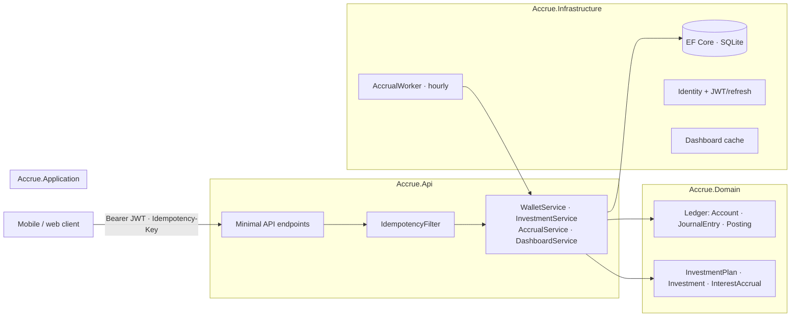
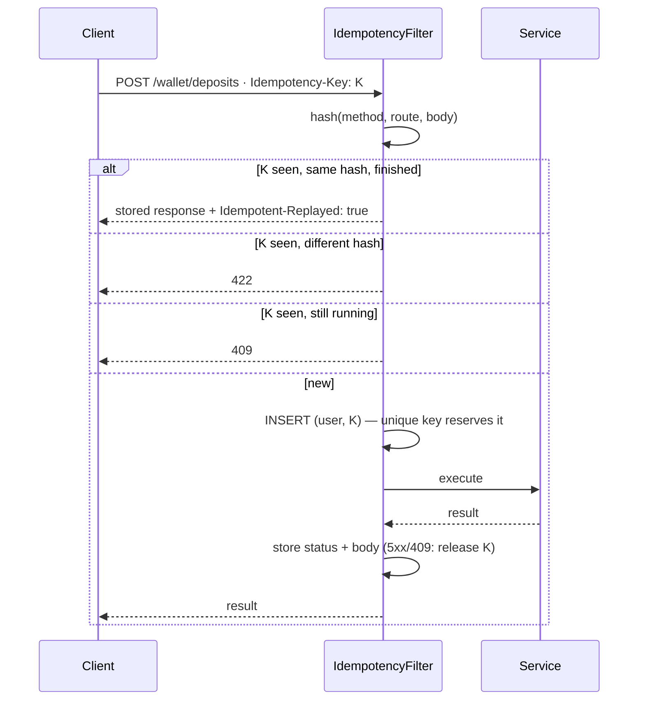

# Architecture

## Shape

Dependencies point inward: Api → Infrastructure → Application → Domain.

**On the `IAppDbContext` port.** Application depends on EF Core's abstractions (`DbSet`, `IQueryable`) rather than a repository per table. This is the widely used Clean Architecture compromise: use cases can compose queries, while the provider, mappings and migrations stay in Infrastructure. Swapping SQLite for PostgreSQL is a one-line change.

## The ledger

Money lives only in **accounts**. Each user has one `Wallet` account and one `Investment` account per position. There are three **system accounts**:

| System account | Role | Balance |
|---|---|---|
| `Funding` | Source of deposits | Grows negative |
| `Payout` | Sink of withdrawals | Grows positive |
| `Interest` | Source of interest | Grows negative |

Every operation is a `JournalEntry` with postings that sum to **zero**:

| Operation | Debit (−) | Credit (+) |
|---|---|---|
| Deposit | Funding | Wallet |
| Withdrawal | Wallet | Payout |
| Transfer | Sender wallet | Recipient wallet |
| Invest | Wallet | Investment account |
| Daily interest | Interest | Investment account |
| Redeem | Investment account | Wallet |

Invariants:

- **Postings balance:** every entry sums to zero, so the whole ledger sums to zero. This is tested.
- **No negative user balances:** a non-system account can't go below zero. The check runs before any balance changes.
- **No double-spend:** `Account.Version` is a concurrency token. Two concurrent debits of the same wallet can't both commit; the loser gets a 409 and can retry safely with its idempotency key.
- **Immutable history:** entries are never edited; corrections are new entries.

## Idempotency

Keys are scoped per user and reserved before any work begins, so two racing copies of the same request can't both execute.

## Interest accrual

- **Rate model:** simple daily interest on principal, `round(principal × rate ÷ 365, 2)`, using the rate snapshotted at purchase.
- **Accrual window:** `AccrualService` posts every complete day (up to yesterday, UTC) that hasn't been posted. It catches up after downtime.
- **Exactly-once guarantee:** the database key `InterestAccruals(InvestmentId, Day)` and the in-order `AccruedThrough` cursor together mean re-running never pays twice. A test runs accrual twice and checks.
- **Scheduling:** `AccrualWorker` runs at startup and hourly. Admins can trigger a run manually.
- **Failure isolation:** each investment commits separately, so one failure can't block or half-pay another.

## Authentication

- **Access tokens:** JWT HS256, 15 minutes, with `sub`, `email`, `name`, `role` and `jti`. Issuer, audience, lifetime and algorithm are all validated.
- **Refresh tokens:** an opaque 256-bit random value, stored as a SHA-256 hash and rotated on every use. Tokens in one sign-in chain share a family; presenting a used token revokes the whole family (theft detection).
- **Signing key:** comes from configuration (user-secrets or environment), must be at least 32 bytes, and is required outside Development.

## Persistence notes (SQLite)

- `DateTimeOffset` is stored as sortable binary ticks, because SQLite can't order or compare offsets natively.
- `decimal` values are stored exactly. Sums are computed in memory over bounded sets, or read from the cached `Account.Balance`.
- Moving to PostgreSQL means swapping `UseSqlite` for `UseNpgsql` and regenerating migrations; the converters then become unnecessary.
